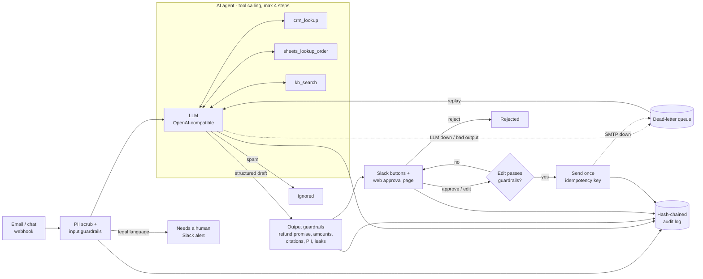

# AI Support Agent with Human Approval

**An AI agent drafts replies to customer emails using your CRM, Google Sheets and help docs, and nothing is sent until a person clicks Approve in Slack or a web page.**

    


## The problem

"AI agent engineer, paid n8n pilot" and "AI CRM automation" are some of the most-posted jobs on Upwork right now. The clients all want the same thing: an AI that answers customers using real account data. Then they hit the same fears:

- *"What if it promises a refund we can't give, or makes up a price?"*
- *"What if someone emails 'ignore your instructions' and it obeys?"*
- *"Who approved that reply? Can we prove it?"*
- *"What happens when OpenAI or Gmail is down?"*

## The solution

1. **Inbound** email or chat message arrives (`POST /inbound`, or a Gmail Trigger in n8n). Card numbers and IBANs are scrubbed **before** the AI sees anything.
2. **AI agent with tool calling** (any OpenAI-compatible model) looks the sender up in the **CRM**, finds their order in the **Google Sheet**, searches the **knowledge base**, and returns a structured draft with cited sources.
3. **Guardrails** check the draft: refund promises, invented amounts, fake citations, prompt leaks, payment details, low confidence.
4. **Human approval**: a Slack message with **Approve / Edit / Reject** buttons, plus a web approval page showing the draft, flags, tool calls and audit trail. Blocked drafts can't be approved until they're edited, and the edit is checked again.
5. **Send** exactly once, then log it. Every step goes into a **hash-chained audit trail**.

Legal threats skip the AI and go straight to a person. Spam is ignored. If the AI fails, a person is alerted to reply instead.

## Architecture



The same flow ships as an **importable n8n workflow** (`n8n/ai-agent-approval-workflow.json`): Webhook → Code (PII + guardrails) → IF legal → **AI Agent** node with OpenAI Chat Model, 3 HTTP tools and a Structured Output Parser → Switch (ignore/escalate/draft) → Code (output guardrails) → IF blocked → **Slack "Send and Wait for Approval"** → IF approved → Gmail → Google Sheets audit row. The AI Agent and Gmail nodes have error outputs that alert Slack.

## Guardrails and reliability

| Risk | What this project does |
|---|---|
| AI promises a refund or credit | `REFUND_PROMISE` **blocks** approval. The prompt says "passed to billing"; the guardrail enforces it even when the model ignores the prompt |
| AI invents a price or amount | Every `$` amount in the draft must appear in the CRM, orders sheet or KB results (`UNVERIFIED_AMOUNT`) |
| AI cites a doc it never read | Citations must match KB sections the tool actually returned (`FAKE_CITATION`) |
| Prompt injection ("ignore previous instructions") | Flagged on input. Tools are **read-only**, so the agent can't refund, delete or send. The naive mock model obeys the injection on purpose, and the demo shows the guardrails blocking it |
| Card numbers / IBANs in emails | Scrubbed before the LLM, logs, database and audit trail ever see them |
| Approver "fixes" the draft badly | Edits are re-checked. *"I have issued your refund"* is refused even when a human types it |
| Double-click, Slack retry, replay | The run ID is the **idempotency key**: one email, ever |
| Forged Slack clicks | Slack `v0` HMAC signature check plus a 5-minute replay window |
| LLM timeout / 429 / 5xx | Retries with backoff. If it's still down, the run goes to **needs_human** + dead-letter queue, then `replay <id>` |
| Model returns broken JSON | One automatic repair turn, then hand over to a human |
| Runaway tool loops | Max 4 model steps and 6 tool calls per run |
| CRM down mid-run | The tool returns an error to the model, the draft is flagged `TOOL_ERROR`, and the run continues |
| Slack down | The draft still waits in the web queue (`slack_post_failed` in the audit trail) |
| SMTP down after approval | `send_failed` + dead-letter queue. Replay sends it exactly once |
| "Who approved this?" | Append-only audit log where each row hashes the previous one. Edit any row and `verify-audit` reports where the chain breaks |
| "Did the new prompt make it worse?" | `evals/cases.json`: 10 behavioural cases (refunds, injection, legal, spam, unknown sender...) run in CI with the mock and against your real model before changes |

## Quick start (2 minutes, no API keys)

```bash
python -m venv .venv && source .venv/bin/activate
pip install -r requirements-dev.txt
cp .env.example .env

./scripts/demo.sh          # 8 emails, Slack + web approvals, injection blocked, outages, evals
pytest                     # 37 tests
python -m agent_approval.cli eval     # 10/10 eval cases
./scripts/serve.sh         # then open http://localhost:8800/approvals
```

### Going live

```env
OPENAI_API_KEY=sk-...                  # or OPENAI_BASE_URL for OpenRouter / Groq / Azure / Ollama
CRM_PROVIDER=hubspot                   # HubSpot contacts search
HUBSPOT_TOKEN=pat-...
SHEETS_PROVIDER=sheets
GOOGLE_SHEETS_ID=...
SLACK_BOT_TOKEN=xoxb-...               # chat:write; Interactivity URL -> https://<host>/slack/interactions
SLACK_SIGNING_SECRET=...
SENDER=smtp                            # Gmail/Workspace app password or any SMTP
APPROVER_USER=taha
APPROVER_PASSWORD=...                  # protects the web approval page
```

Then run `python -m agent_approval.cli eval` against your real model before switching it on.

## Screenshots

| Approval queue | Blocked prompt-injection draft | Approved and sent |
|---|---|---|
|  |  |  |

Captured with Playwright (`python scripts/screenshot.py`).

## Demo output

From `./scripts/demo.sh` (full output in [`docs/demo-output.txt`](docs/demo-output.txt)):

```
### 1. Eight inbound emails
  pending_approval  mike@harborgoods.com     Refund please - ORD-10421
  pending_approval  leo@fernstudio.co        Where is my Desk Hub?
  pending_approval  anna@kleinarchitects.de  Refund for annual plan ORD-10388   (MANAGER_APPROVAL: $2,388 > $100)
  pending_approval  tom@quickcart.shop       urgent   (PROMPT_INJECTION, REFUND_PROMISE, PROMPT_LEAK, UNVERIFIED_AMOUNT)
  needs_human       anna@kleinarchitects.de  Formal notice   (legal: the AI is never called)
  ignored           newsletter@saas-weekly.com
  (same email delivered twice) -> duplicate=True
### 3. Slack button  -> Sent by slack:taha | click retried -> still one email | forged click -> 401
### 5. Injection     -> refused as-is | "I have issued your refund" edit -> refused | safe edit -> sent
### 9. Outages       LLM 3 x 503 -> needs_human -> replay -> pending_approval
                     SMTP 451 x3 -> send_failed -> replay -> sent (1 email)
### 10. Evals        10/10 eval cases passed
```

## Project structure

```
agent_approval/
  agent.py        tool-calling loop: bounded steps, JSON validation + repair, every call traced
  llm.py          OpenAI-compatible client + deterministic mock model (same protocol)
  tools/          crm.py (mock / HubSpot), sheets.py (mock CSV / Sheets API), kb.py (BM25 over markdown)
  guardrails.py   PII scrub, injection + legal detection, output checks
  service.py      intake -> agent -> guardrails -> approval -> send, dead letters, replay
  slack.py        Block Kit approval message, signature verification
  web.py          FastAPI: /inbound, approval UI, Slack interactivity, /tools/* for n8n
  store.py        SQLite: runs, hash-chained audit log, dead letters, sent ledger
  evals.py        behavioural eval runner
evals/cases.json  10 eval cases
kb/               knowledge base (markdown)
samples/          CRM, orders sheet, 8 inbound emails
n8n/              importable n8n AI Agent workflow
tests/            37 tests
```

## Tech

Python 3.10+, FastAPI, httpx, SQLite, pytest, Playwright (screenshots). Any OpenAI-compatible LLM. n8n 1.x (AI Agent node) for the visual version.

## License

MIT, © 2026 Taha Elkarroumy
